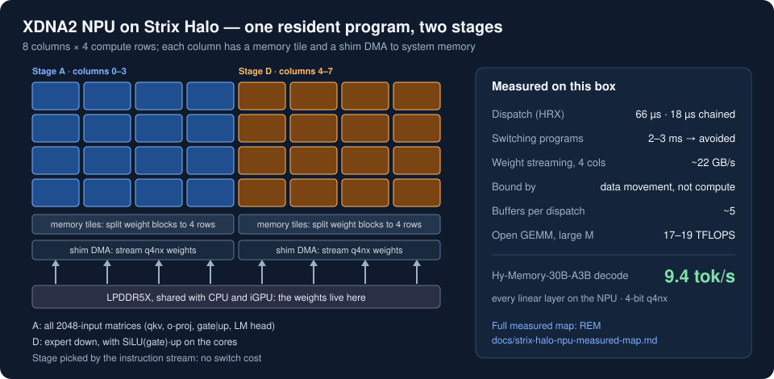

# NPU Wrench

Local-AI work on the AMD Ryzen AI (XDNA2) NPU, built on AMD's open NPU stack. The first release runs a
whole 30B MoE model's decode on the NPU of a Strix Halo.

> **Status, 2026-10-18: early release.** Hy-Memory-30B-A3B runs end to end on the AMD XDNA2 NPU and
> matches llama.cpp's greedy output on our check prompt. v0.2 adds batched prompt processing (prefill) on
> the NPU. Attention still runs on the CPU. Speed work is ongoing and help is welcome: see
> [CONTRIBUTING.md](CONTRIBUTING.md).

This runs [tencent/Hy-Memory-30B-A3B](https://huggingface.co/tencent/Hy-Memory-30B-A3B), a 30B-total,
3B-active MoE trained to write long-term memories for agents, on the NPU of an AMD Ryzen AI Max+ 395
(Strix Halo). Every linear layer (attention projections, 128 routed experts plus the shared expert,
the dense first layer and the LM head) runs on the NPU as a fused 4-bit matrix-vector product; norms,
RoPE, attention and the router run on the CPU. The point is a background memory writer that leaves
the iGPU to the foreground model and uses no CPU cores for the weight math.

It is built entirely on AMD's open NPU stack: the q4nx GEMV kernel from mlir-aie, the IRON operator
library, and the HRX runtime from FastFlow-SDK.

## The NPU map

[](https://github.com/boxwrench/REM/blob/main/docs/strix-halo-npu-measured-map.md)

What the XDNA2 NPU in a Strix Halo can and cannot do, measured on one box: GEMM rates by shape, the
gap between the open and shipped compilers, dispatch and switching costs, numerical error, contention
with the iGPU in both directions, and which jobs it is good for. The full map is in REM:
[docs/strix-halo-npu-measured-map.md](https://github.com/boxwrench/REM/blob/main/docs/strix-halo-npu-measured-map.md).
The same envelope from the telemetry side is in xdna-top:
[docs/experiments/strix-halo-npu-envelope.md](https://github.com/boxwrench/xdna-top/blob/main/docs/experiments/strix-halo-npu-envelope.md).

## Results, one Strix Halo

Greedy decode, one prompt of 63 tokens (a memory-extraction turn, `examples/check_prompt.txt`), 64 generated tokens.
Median ms/token of repeated runs (spread under 1.5 %). Prefill from the first 512 / 2048 tokens of a public
synthetic dialogue, two runs each (spread under 1.5 %).

<!-- BENCH:START -->
| Path | Decode tok/s | ms/token | Matching tokens vs llama.cpp Q4_K_M |
|---|---:|---:|---:|
| NPU, v0.2.2, short context (check prompt) | **12.6** | **79.5** | 58 of 64 |
| NPU, v0.2.2, after a 2K-token prompt | **10.3** | **97** | — |
| NPU, v0.1, short context | 9.4 | 106.4 | 56 of 64 |
| CPU sidecar for comparison (llama.cpp, 3 threads at idle priority, beside an iGPU model) | 3.9 | 256 | — |

| Prompt (prefill) | NPU prefill, v0.2 | of which NPU / CPU | Token by token (v0.1) |
|---:|---:|---:|---:|
| 512 tokens | 7.1 s (72 tok/s) | 4.6 / 2.5 s | ~54 s |
| 2048 tokens | **18.0 s (114 tok/s)** | 5.3 / 12.7 s | ~212 s |

A 2K-token memory-writer span with a 300-token reply takes about 47 s, against about 80 s for the 3-thread
CPU sidecar (whose 3.9 tok/s was also measured after a long prompt). v0.2 reported 87 ms/token measured at a
short context only; its decode attention slowed to ~305 ms/token after a 2K prompt, fixed in v0.2.1. Beside a llama.cpp foreground on the iGPU the NPU writer costs it 5-6 % decode, steadily; an idle-priority
3-thread CPU writer costs about the same on average, with occasional stalls, and is faster per write today
(docs/METHOD.md, "Running beside an iGPU model"). Prompt processing alone is still slower than llama.cpp's CPU prefill (~580 tok/s with 3
threads) because attention runs on the CPU; an NPU attention kernel is the next lever.
<!-- BENCH:END -->

<!-- RECEIPT:START -->
| Item | Value |
|---|---|
| Hardware | AMD Ryzen AI Max+ 395, 128 GB LPDDR5X-8000, XDNA2 NPU (rev 0x11, firmware 1.1.2.65) |
| Software | Linux 7.3.0-rc6, amdxdna DKMS 7.0.0-rc1; mlir-aie 1.4.4, llvm-aie 22.0.0.2026092101, amd/IRON f280ccf; HRX 0.1.0 (FastFlow-SDK 0.1.0.dev202610050001); Python 3.12, numpy 2.5 |
| Run | `tools/check.py`, greedy, 64 generated tokens; GPU fabric clock held at its top level; NPU QoS unchanged |
<!-- RECEIPT:END -->

**Output check.** The first 56 greedy tokens match llama.cpp's Q4_K_M output token for token,
including every extracted fact; the first difference is in the model's invented next user turn after
the list. This is a smoke check on one prompt, not a quality evaluation. A
per-layer comparison against a BF16 reference is in [docs/METHOD.md](docs/METHOD.md): the routed-expert
error is 8.8 % against llama.cpp Q4_K_M's 6.7 %, mostly from the 4-bit down projection.

## How it works

- **One resident NPU program.** Switching NPU programs costs 2-3 ms, so the whole model runs on one
  xclbin with two persistent stages on disjoint columns: stage A (columns 0-3) computes every matrix
  with 2048 inputs, stage D (columns 4-7) the expert down projections. The stage is chosen by the
  instruction stream, which costs nothing to switch.
- **Fused 4-bit GEMV.** AMD's `q4nx_accumulate` dequantizes inside the cores; no 16-bit weights are
  written. The down stage computes SiLU(gate)·up from the gate/up output on the cores.
- **Size-agnostic stage.** Each stage-A core computes one round (32 outputs per core, 512 per stage) per activation it receives, so the
  output size lives only in the instruction stream: qkv (5120), o-proj halves (2048), expert
  gate+up (1536), the dense first layer as 9 chunks, the LM head as 24 blocks.
- **CPU side.** RMS norms, NEOX RoPE, GQA attention over the KV cache and the sigmoid router with
  selection bias, in numpy.
- **Prefill.** The whole prompt goes through each layer at once. IRON's `DequantBFP`, with its input
  pattern changed to read the decode weights in place, writes the bfp16 operand that IRON's `flm.GEMM`
  multiplies; experts run on just the tokens routed to them. No second copy of the weights.
- **No needless cache flushes.** HRX flushes every argument buffer before a dispatch; weights never
  change after loading, so their flush is skipped (decode 106 -> 87 ms/token).
- **Attention as batched matmuls.** The KV cache is stored as (head, dim, position) for K and (head,
  position, dim) for V, so decode and prefill attention are BLAS matmuls; only the diagonal block is masked.

[docs/METHOD.md](docs/METHOD.md) has the measured costs (dispatch, switching, streaming rate, buffer
limits) and the pitfalls.

## Run it

You need an XDNA2 NPU with the `amdxdna` driver, Python 3.12, and:

1. mlir-aie 1.4.4 with llvm-aie 22.0.0.2026092101 (Peano), in a venv.
2. [amd/IRON](https://github.com/amd/IRON) at `f280ccf` on `PYTHONPATH`.
3. HRX: `libhrx.so` from the [FastFlow-SDK](https://github.com/ROCm/FastFlow-SDK) release, with
   `LIBHRX_DIR` pointing at its directory and `NPU_RUNTIME=hrx`.
4. `pip install ml_dtypes tokenizers jinja2`.

```sh
hf download boxwrench/Hy-Memory-30B-A3B-q4nx-wrench --local-dir ./Hy-Memory-30B-A3B-q4nx-wrench         # ~19.5 GB
export PYTHONPATH=/path/to/IRON LIBHRX_DIR=/path/to/hrx/lib NPU_RUNTIME=hrx
ulimit -n 65536                                           # one buffer per weight matrix
python tools/run.py --weights ./Hy-Memory-30B-A3B-q4nx-wrench --chat examples/extract.json --max-new 256 \
    --experts-per-dispatch 3 --prefill 4096                # NPU prefill for prompts up to 4096 tokens
```

The first run compiles the NPU program (about 15 s, cached in `./build`). Loading the weights onto
the NPU takes about 10 s.

On Strix Halo, if a GPU model runs at the same time, hold the GPU fabric clock at its top level first
(GPU and NPU share it; a moving clock can hang NPU work).

To pack the weights yourself from the BF16 checkpoint (about 30 minutes on 16 cores):

```sh
hf download tencent/Hy-Memory-30B-A3B --local-dir ./Hy-Memory-30B-A3B   # 60 GB
python tools/pack.py --hf ./Hy-Memory-30B-A3B --out ./Hy-Memory-30B-A3B-q4nx-wrench --procs 16
```

## Reproduce the check

```sh
python tools/check.py --weights ./Hy-Memory-30B-A3B-q4nx-wrench --n 64
python tools/check.py --weights ./Hy-Memory-30B-A3B-q4nx-wrench --n 64 --experts-per-dispatch 3
```

`results/reference-llamacpp.json` holds the prompt token ids and llama.cpp's greedy ids.

## Related projects

- [REM](https://github.com/boxwrench/REM): a bounded-context memory sidecar for local agents. Its
  background compaction is what this NPU writer is for. Its [measured NPU map](https://github.com/boxwrench/REM/blob/main/docs/strix-halo-npu-measured-map.md)
  is the reference for everything above. [Hardware context](https://github.com/boxwrench/REM/blob/main/docs/hardware-context.md)
  explains what the NPU is and how it shares the chip with the CPU and iGPU;
  [IOMMU and the NPU on Strix Halo](https://github.com/boxwrench/REM/blob/main/docs/strix-halo-iommu-npu.md)
  covers the platform setup, and REM links the prebuilt PerfOpt test kernel.
- [xdna-top](https://github.com/boxwrench/xdna-top): terminal telemetry for AMD iGPUs and GPUs with
  Ryzen AI NPU context; useful for watching the GPU while the NPU writer runs.
- [Ling Wrench](https://github.com/boxwrench/ling-wrench): the GPU-side sibling, calibrated quants
  and measurements for Ling-3.0/3.1-flash.

## Credits and license

- Model: [tencent/Hy-Memory-30B-A3B](https://huggingface.co/tencent/Hy-Memory-30B-A3B), Apache-2.0.
  The packed weights are a quantized derivative under the same licence.
- Kernel and operator library: [mlir-aie](https://github.com/Xilinx/mlir-aie) and
  [amd/IRON](https://github.com/amd/IRON) by AMD; runtime: HRX from AMD FastFlow-SDK.
- Reference for the check: [llama.cpp](https://github.com/ggml-org/llama.cpp).
- This repository is Apache-2.0; see [LICENSE](LICENSE). Files derived from AMD's code keep AMD's
  copyright and are marked as modified; details in [NOTICE](NOTICE).
